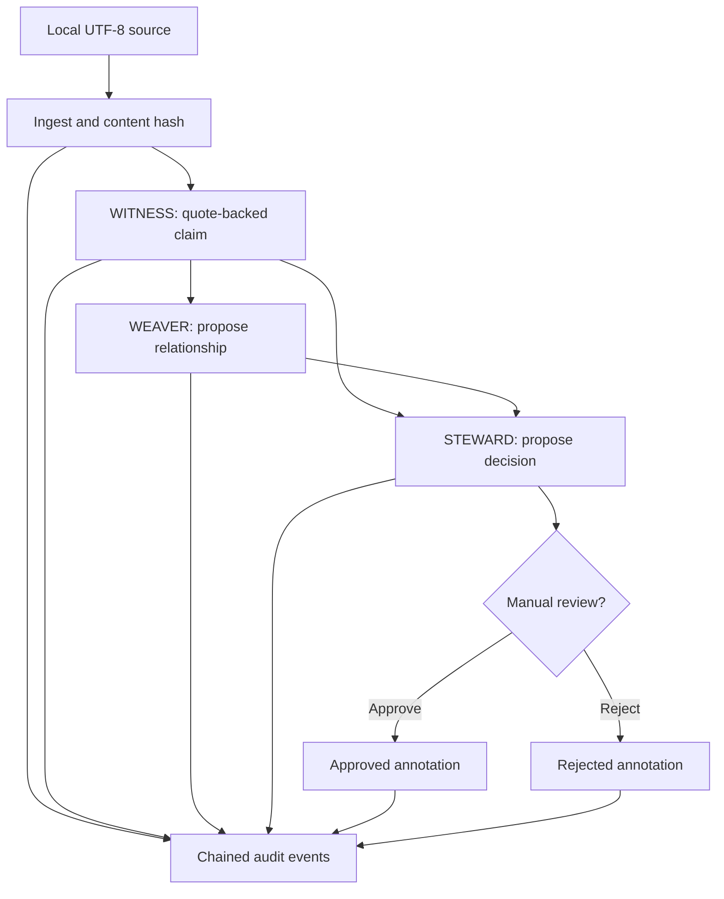

# Architecture: 3 brains, 6 record types, 9 invariants

## 3 brains

**WITNESS (episodic/evidence)** stores source originals, SHA-256 digests, origins, and claims with verbatim quoted anchors. A document is evidence that *its text contains a statement*, not evidence that the statement is correct.

**WEAVER (relational/semantic)** represents typed edges between claims. Supported edge types in Rung 1: supports, contradicts, related. All edges are proposals. No automatic synthesis is implemented yet.

**STEWARD (procedural/decision)** records evidence-linked decision proposals and manual review annotations. Nothing is executed based on these records.

## 6 primary record types

- source: original text, project scope, SHA-256, recording metadata
- origin: where a deduplicated source was observed
- claim: attributed statement with a verbatim quote and offset
- relation: proposed, typed connection between claims
- decision: evidence-linked recommendation and review status
- audit event: transactional change log with a previous-hash link
- GitHub import: source ID, repository, pinned commit SHA, file path, verified Git blob SHA, retrieval timestamp
- vault revision: historical source snapshots and versioned active path mapping
- time annotation: append-only, explicitly asserted valid-time interval; original recorded time preserved

Tables include sources, source_origins, claims, relations, decisions, decision_evidence, audit_events, github_imports, vault_batches, vault_notes, vault_revisions, claim_time_annotations, and SQLite FTS5 search_fts.

## 9 invariants

1. Preserve exact imported text and its content digest.
2. Anchor each claim to an exact quote in a source.
3. Never automatically promote proposed connections to facts.
4. Require evidence claims for every decision proposal.
5. Explicit project scope on every data operation.
6. No application-level silent writes: record an audit event transactionally.
7. No autonomous execution, background polling, or external network calls.
8. Use portable open formats without provider lock-in.
9. Treat every imported source as untrusted data, never model instructions.

## Data flow

## Persistence and query boundaries

One SQLite database is used by three logical roles, not three separate LLMs. Rung 2a adds explicit, public, commit-pinned GitHub HTTPS reads in WITNESS; no automatic crawler or remote write capability. SQLite WAL is enabled for local concurrency. FTS5 performs scoped lexical retrieval. Rung 2c additionally restricts citation search to claims with exact quote anchors, warns about old observations, and abstains on missing quote-backed evidence. There is no vector store, LLM reasoning API, multi-user authentication, or network listener.

Project scopes are organizational labels and cannot be trusted as authorization boundaries. Model text injected into a source must never be passed into an agent's instruction channel.

## Future integrations

- **PhiOS:** stable local read API behind an authorization layer
- **PhiMadaPrime:** three visibly distinct lanes for evidence, hypotheses, and decisions
- **PhiBots:** constrained evidence submissions and scoped task handoffs
- **PhiRSI:** record test outcomes and observed lessons, not only claimed successes
- **GitHub:** read-only, allowlisted ingestion of selected commits/PRs/check runs with SHAs
- **Obsidian:** reversible importer plus optional Markdown snapshot export
- **MCP:** resources/tools after authentication, authorization, audit, and sandboxing

Future retrieval should check authorization, combine FTS with optional local embeddings, rerank by relevance and source freshness, and abstain when claims lack reliable supporting evidence.

**The three brains are functional subsystems, not claims about self-aware software or separate consciousnesses.**
